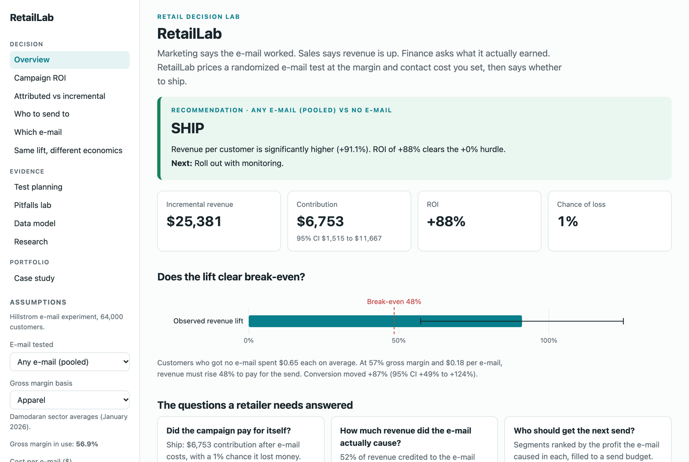
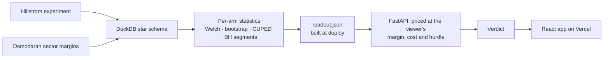

# RetailLab: Should the Retailer Keep Sending the E-mail?

[](https://github.com/advaithvemurisai/retail-ab-lab/actions/workflows/ci.yml)

**[▶ Open the live app](https://retail-ab-lab.vercel.app/)**. No login: change the margin, cost per e-mail or return hurdle and the verdict updates live.

A decision lab built on a real randomized experiment, the Hillstrom e-mail test: **64,000 customers** split evenly between a men's e-mail, a women's e-mail and no e-mail, with two weeks of visits, purchases and spend. It prices the measured lift at real sector margins and the cost of sending, then returns one recommendation: **Ship, Don't Ship, Keep Testing or Don't Trust**.



## Results at a glance

At the default assumptions: apparel gross margin (56.9%, Damodaran, January 2026) and $0.18 per e-mail sent. Every figure changes live in the app.

| Question | Answer |
|---|---|
| Did the campaign pay for itself? | **Yes, ship it.** $6.8k contribution after product and sending costs (95% CI $1.5k to $11.7k), ROI +88%, a 1% chance it lost money |
| Was the lift real, and big enough? | Revenue per customer rose **91%** (95% CI +57% to +125%) against the **48%** needed to break even |
| How much revenue did the e-mail actually cause? | **52%** of the $53k credited to it would have come in anyway; attribution overstates its return about 2.1× |
| Which e-mail should roll out? | **The men's.** +118% lift and +143% ROI, against +65% and +34% for the women's, which has a 21% chance of losing money. The men's wins head to head (p = 0.03 after correction) |
| Who should get the next send? | Every past-year spend band except $200 to $350: 51.7k of 64k customers, $1.5k more contribution than mailing everyone |
| Would the same lift pay in another business? | In apparel, yes. At grocery (26% margin, needs a 105% lift) and restaurant (32%, needs 86%) margins it is uncertain |
| How long should the next test run? | About **7 weeks** at 10k mailable customers a week (70.8k customers) to detect the break-even lift with 80% power |
| Can the experiment be trusted? | Yes. Arms of 21,306, 21,307 and 21,387 match the 1:1:1 design (split check p = 0.90), and pre-period spend and recency are balanced |

## The finding I didn't expect

CUPED is the standard way to make experiments finish sooner: adjust each customer's outcome with a pre-period covariate, and variance falls by the squared correlation. Hillstrom ships with past-year spend, so it looked like free sensitivity.

It isn't. Past-year spend and two-week spend correlate at **ρ = 0.022**, so CUPED removes **0.05%** of the variance and saves **0.00 weeks** on the next test. Fewer than 1% of customers buy anything in the two-week window, and a customer's annual history barely predicts who will. The app keeps CUPED on, says how little it helps, and the test-planning page shows the curves with and without it. A covariate with ρ = 0.5 would cut the sample by 25%.

Two bugs from the first version were also worth catching, and each now has a regression test:

- **A healthy experiment flagged as broken.** The split check compared control against both e-mails pooled at 50/50. By design that split is 1:2, so the real experiment came out as **Don't Trust**. It now tests the 1:1:1 design.
- **An interval on the wrong scale.** The contribution interval was per customer but compared with the cost of the whole campaign. It is now scaled by customers e-mailed and priced at the sidebar's margin and cost.

## The business problem

Marketing says the e-mail campaign worked. Sales says revenue is up. Finance asks what it actually earned, and whether to keep sending.

1. **Credit isn't cause.** Click-through reports credit the e-mail with every purchase an e-mailed customer makes, including the ones that would have happened anyway.
2. **Lift isn't profit.** A revenue lift only matters if it covers the product margin and the cost of sending, and the same lift can pay in one business and not another.
3. **Tests can fool the team.** Peeking at results, a broken split or slicing until something looks significant can all produce a winner that isn't real.

## What's in it



| Step | What it does | Method |
|---|---|---|
| **Trust** | Stops interpretation if the experiment broke | Sample-ratio mismatch (chi-square against the 1:1:1 design, p < 0.001); standardized mean differences on pre-period covariates |
| **Lift** | Revenue and conversion effect of the e-mail | Welch test on revenue per customer with a t interval; two-proportion z-test with a delta-method interval on conversion |
| **Variance reduction** | Tighter estimates from pre-period data | CUPED on past-year spend, with θ estimated treatment-blind on both arms |
| **Economics** | What the lift earned | Incremental revenue × gross margin − cost per e-mail; the contribution interval comes from 1,000 bootstrap resamples within each arm |
| **Power** | Whether a null result means anything, and how long to run | Normal-approximation power at the break-even lift, using each arm's own spread and the traffic split |
| **Targeting** | Who gets the next send | Segment effects with Benjamini-Hochberg correction, then a send budget filled by contribution per dollar |
| **Creatives** | Men's or women's e-mail | Pairwise Welch tests with BH correction across the three comparisons |
| **Verdict** | One recommendation | The rules below, checked in a fixed order |

## The decision rules

The first rule that applies decides:

1. **Trust.** If the customer groups aren't the sizes the design called for, something broke: **Don't Trust**.
2. **Harm.** If revenue is significantly lower, even the optimistic end of the contribution interval loses money, or a customer group is significantly worse off: **Don't Ship**.
3. **Evidence.** If the lift is significant and the ROI clears the hurdle: **Ship**, with a staged rollout when the chance of loss is above 10%. If it misses the hurdle: **Don't Ship**.
4. **Power.** If there's no significant lift but the test had 80% power to see break-even: **Don't Ship**. Otherwise, **Keep Testing**, with the weeks needed.

The order means a striking profit number from a broken experiment can never reach Ship. The pooled e-mail is the primary comparison. Picking one creative after the fact counts as one of two looks, so its p-value is doubled before the verdict, and a lucky winner can't clear the bar alone.

## What can fool the team

The Pitfalls page runs each trap on this data, so the size of the risk is measured rather than asserted:

| Trap | What happened | The check that catches it |
|---|---|---|
| Peeking at a test with no effect, stopping at the first p < 0.05 | 10 looks declared a winner **20%** of the time, against the promised 5% (2,000 simulated A/A tests per schedule) | Fix the sample size up front, or use sequential tests |
| A logging bug drops 5% of e-mailed non-buyers | The reported lift rose from +91% to **+101%** | The split check fails (p = 6×10⁻⁸) |
| Slicing four ways until a segment looks significant | With assignment shuffled so nothing works, **45%** of runs found a significant segment | BH correction brings it to 21%, and to 4–9% within each slice |

## How the web app works

The statistics that need customer-level data are computed once per deploy: [`scripts/build_web_data.py`](scripts/build_web_data.py) runs them for every e-mail and CUPED setting and writes `readout.json`. The sidebar assumptions only enter afterwards, through arithmetic in [`pricing.py`](src/retaillab/pricing.py), so precomputing loses nothing.

- **One copy of the rules.** The FastAPI app ([`api.py`](src/retaillab/api.py)) prices the readout with the same `pricing.py` that `analyze()` uses. A test checks that the API and a fresh `analyze()` on the customer data give the same verdict text and the same figures, to floating-point rounding.
- **A small function.** The pricing layer uses only the standard library, so the Vercel function bundles FastAPI and four modules, with no pandas or scipy. A test fails if the API ever imports them.
- **Fast enough for a slider.** Responses take about 0.15 s and are cached at Vercel's edge. A slider drag is debounced, so 21 steps send one request.

## Honest limitations

- **The cost per e-mail is an assumption** ($0.18 by default, adjustable).
- **Margins are sector averages** for US public companies (Damodaran), not one retailer's books.
- **Two weeks of outcomes.** Longer-run effects such as unsubscribes or habit aren't counted.
- **No timestamps.** Hillstrom has none, so the peeking risk is simulated rather than replayed.
- **Segment estimates are noisy.** The targeting plan acts on point estimates by default; a toggle restricts it to segments that survive correction.
- **2008 data.** The experiment is old; read the results as a worked method, not a current benchmark.
- **Fixed analysis settings.** The 5% significance level and the segment definitions are fixed. Changing them means recomputing on the customer data, not just re-pricing.

## How it's evaluated

- **Tests.** 49 Python tests, including:
  - every verdict branch;
  - a regression test for each bug above;
  - power against statsmodels and Welch intervals against scipy;
  - the warehouse SQL P&L against the Python P&L;
  - the API against `analyze()`, plus the import guard;
  - every Streamlit page rendering in demo mode.
- **CI.** Every push runs the Python tests, then lints and builds the web app.

## Repository layout

```
src/retaillab/
  analysis.py    one readout: validity, lift, CUPED, segments, then pricing
  pricing.py     everything the assumptions touch: P&L, intervals, power, verdict (stdlib only)
  decision.py    the verdict rules
  estimate.py    Welch, proportions, bootstrap, BH, pairwise and segment effects
  validity.py    sample-ratio mismatch and covariate balance
  variance.py    CUPED
  resampling.py  peeking simulation
  warehouse.py   DuckDB star schema (sql/warehouse.sql)
  webdata.py     the precomputed readout the web API prices
  api.py         FastAPI app
web/             React + Vite + TypeScript app; web/api/index.py is the Vercel entry point
app/             Streamlit app (being retired)
scripts/         data download, warehouse build, web data build
tests/           Python tests
```

## Run it

```bash
git clone https://github.com/advaithvemurisai/retail-ab-lab.git
cd retail-ab-lab
pip install -r requirements.txt fastapi httpx uvicorn
python scripts/get_data.py          # downloads the Hillstrom data and Damodaran margins
python -m pytest -q

# web app and API
cd web && npm install
npm run data                        # writes public/data/readout.json
npm run api                         # FastAPI on :8000, docs at /api/docs
npm run dev                         # second terminal; forwards /api to :8000
```

Without the downloaded data, everything runs on clearly labelled synthetic data instead.

## Deploy

- **Vercel.** Import the repo with root directory `web/`; every push to `main` redeploys. [`web/vercel.json`](web/vercel.json) downloads the public data and builds `readout.json` in a throwaway virtualenv. It then copies the API's pure-Python modules next to the function and builds the app. If the download fails, the build fails rather than shipping demo numbers.
- **CI.** [`.github/workflows/ci.yml`](.github/workflows/ci.yml) runs the Python tests, then lints and builds the web app.

## Data

The [Hillstrom MineThatData e-mail experiment](https://blog.minethatdata.com/2008/03/minethatdata-e-mail-analytics-and-data.html) (Kevin Hillstrom, 2008) and [sector gross margins](https://pages.stern.nyu.edu/~adamodar/New_Home_Page/datafile/margin.html) from Aswath Damodaran (NYU Stern). Neither is committed; both are downloaded at build time (see [DATA_SOURCES.md](DATA_SOURCES.md)). The methods follow published work on online experiments from Microsoft, Stanford and others (see [REFERENCES.md](REFERENCES.md)).

**Stack:** Python · pandas · SciPy · statsmodels · DuckDB · SQL · FastAPI · React · TypeScript · Recharts · Vercel · GitHub Actions
